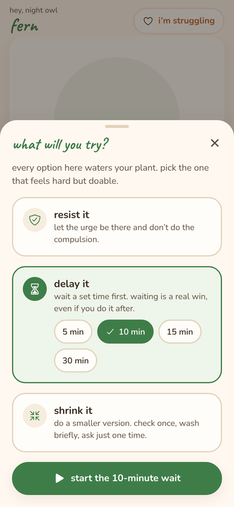
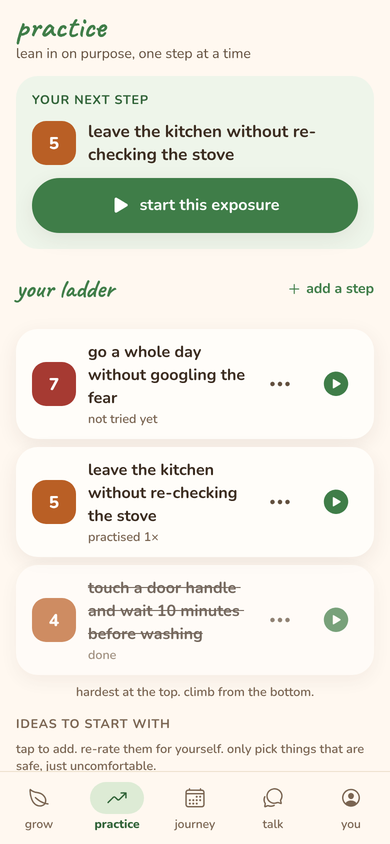

# 🌱 Abloom

A gentle companion app for people with OCD: resist a compulsion, water your plant, watch it grow.

Abloom makes the hardest part of OCD recovery, *not* doing the compulsion, into something you can see. When an urge hits you can resist it, delay it, or shrink the ritual. Any of these waters a hand-drawn plant that grows over the days you practise. The plant never wilts, and there are no streaks to lose.

<p>




</p>

## What's inside

| | |
|---|---|
| **i have an urge** | The core loop. Name the urge, rate it, then choose **resist**, **delay** (5–30 min) or **shrink**. Ride it out with a timer and uncertainty-tolerance prompts, re-rate it, then water the plant. Partial wins count. Slips are noted kindly and don't water. |
| **Quick log** | Log an urge you already handled in one tap, with undo. |
| **Practice** | An exposure ladder rated 0–10, starter ideas matched to your compulsion types, and guided exposures (prediction → before, during and after anxiety → what you learned). |
| **Learn** | Seven one-minute lessons, one unlocking each day: the OCD loop, hidden compulsions, reassurance, exposure, uncertainty, thoughts vs. actions, slips. |
| **Journey** | A 5-week calendar, how you meet urges, urge strength before and after, time of day, top compulsions, exposure history, your forest, and a summary to share with a therapist. |
| **Talk** | An optional Claude-powered companion that names compulsions and thinking traps and is built to **never give reassurance**. Consent-gated, with crisis detection, a report button, and a gentle pause for long chats. |
| **I'm struggling** | Ride the urge, breathing, 5-4-3-2-1 grounding, and crisis lines (988, Crisis Text Line, Samaritans, findahelpline). |
| **You** | Your plant, your compulsions, a daily reminder (optional, no badges), calm mode (hides all numbers), AI and analytics toggles, backup and restore, delete everything. |

## Design principles
- **Recovery-informed, not clinical.** Copy is warm and lowercase. We praise the *choice*, never promise a fear won't come true, and never reassure.
- **No punishment.** Growth counts *water days*, so a missed day pauses growth and never undoes it. Streak counters and badges can feed OCD (JMIR 2026), so the home screen has neither.
- **The tracker shouldn't become a ritual.** Several waterings in a day still count as one water day. After eight logs in a day, a gentle nudge says it's a tool, not a ritual. Calm mode hides numbers entirely.
- **Private by default.** All app data stays on the device. No accounts. Analytics are opt-in and never include what you log.
- **No API keys in the app.** The companion talks to a small Cloudflare Worker that holds the key and enforces the system prompt, safety handling and rate limits.

See `docs/product-research.md` for the evidence behind these.

## Tech
React Native 0.81 · Expo SDK 54 · React 19 · AsyncStorage · Ionicons · Caveat + Nunito · Cloudflare Worker + Claude API. Runs on iOS, Android and web.

```
App.js                    fonts, splash, error boundary
src/AbloomApp.js          providers + tab shell
src/theme.js              design tokens (colour, type, spacing)
src/content/              copy, compulsions, lessons, exposure ideas, crisis resources
src/lib/model.js          data model, migrations, growth + insights (pure, tested)
src/lib/                  storage, analytics, notifications, AI client, sharing, haptics
src/state/store.js        app state + actions
src/components/           UI kit, plant, toast, crisis card, picker
src/flows/                urge flow, exposure flow, support, lessons, reminders (sheets)
src/screens/              onboarding, grow, practice, journey, talk, you
server/ai-proxy/          Cloudflare Worker for the AI companion
test/                     node:test unit tests
docs/                     launch checklist, store listing, ad copy, research
```

## Running it
```
npm install
npx expo start          # i = iOS, a = Android, w = web
npm test                # data model + AI proxy tests
```

The app works fully without the AI companion. To turn it on, deploy the proxy, then set `.env`:
```
cd server/ai-proxy
npx wrangler secret put ANTHROPIC_API_KEY
npx wrangler deploy
```
Copy `.env.example` to `.env`, set `EXPO_PUBLIC_AI_PROXY_URL`, and restart Expo. The full launch steps are in [`docs/launch-checklist.md`](docs/launch-checklist.md).

## A note on scope
Abloom is a self-help tool, not a medical device or a substitute for treatment. If OCD is affecting your life, an ERP-trained therapist is the gold standard. The [International OCD Foundation](https://iocdf.org/find-help/) has a directory.
