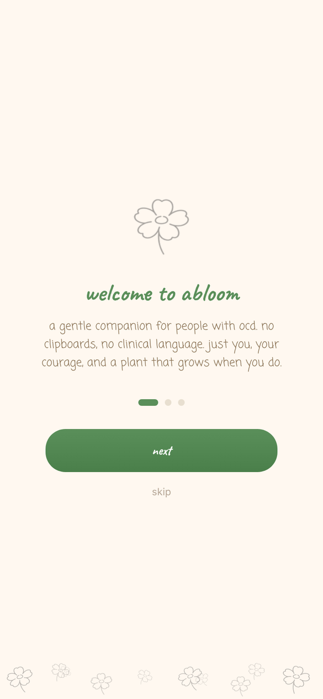
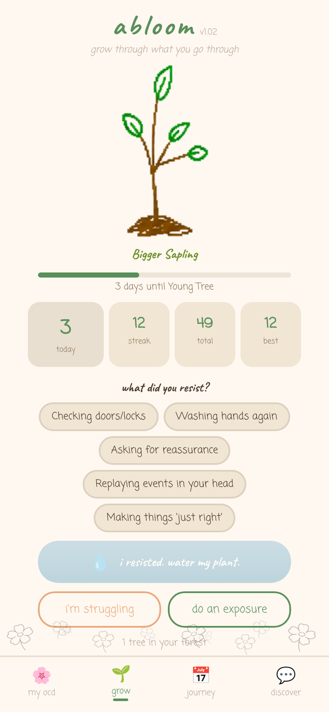
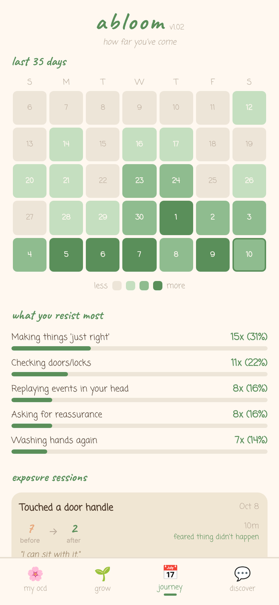
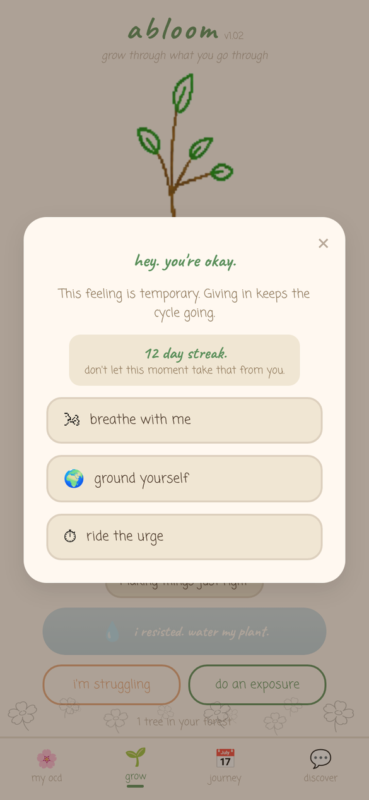

# 🌱 Abloom

**A gentle companion app for people with OCD — resist a compulsion, water your plant, watch it grow.**

Abloom turns the hardest part of OCD recovery — *not* doing the compulsion — into something you can see. Every time you resist, you water a hand-drawn plant. Keep a daily streak and it grows from a seedling into full bloom; finish a tree and it joins your forest. No clipboards, no clinical language.

<p align="center">
  
  
  
  
</p>

## Features

- **Track what your OCD looks like** — search 16 common compulsions across checking, contamination, reassurance-seeking, mental rituals, symmetry and avoidance, or add your own.
- **Water your plant** — log each compulsion you resist. A daily streak grows the plant through five stages (Seedling → Tiny Sapling → Bigger Sapling → Young Tree → Full Bloom), with animations and haptic feedback.
- **"I'm struggling" support** — when an urge hits: a paced breathing exercise, 5-4-3-2-1 grounding, and an urge timer to ride the wave out.
- **Exposure practice (ERP)** — guided exposure and response prevention sessions: pick a trigger, rate anxiety before, during and after, and record whether the feared outcome happened.
- **Journey** — a 35-day activity calendar, a breakdown of what you resist most, and a history of exposure sessions with before/after anxiety.
- **AI companion** — a Claude-powered chat that helps you name compulsions and spot cognitive distortions (catastrophizing, thought-action fusion, intolerance of uncertainty…). It's deliberately designed to **never give reassurance**, since reassurance-seeking is itself a compulsion.
- **Private by default** — all data stays on the device (AsyncStorage). No accounts.

## Design decisions

- **Recovery-informed, not clinical.** Copy is warm and lowercase; encouragement focuses on tolerating discomfort rather than on the fear being "irrational", in line with how ERP works.
- **The tracker shouldn't become a ritual.** After eight logs in one day, the app gently reminds the user that it's a tool, not a ritual, and that they don't need to track perfectly — so logging itself doesn't turn into a compulsion.
- **No API keys in the app.** The AI companion calls a tiny serverless proxy (`server/ai-proxy`) that holds the key and enforces the system prompt and message limits, so the endpoint can't be reused as a general-purpose Claude proxy.
- **Local-calendar dates.** Streaks are computed from the user's local date, so "today" doesn't roll over early in the evening for users west of UTC.

## Tech stack

| | |
|---|---|
| App | React Native 0.81 · Expo SDK 54 (New Architecture) · React 19 |
| UI | React Native `Animated`, `expo-linear-gradient`, `expo-haptics`, Caveat & Coming Soon fonts, custom illustrated plant stages |
| Storage | `@react-native-async-storage/async-storage` |
| AI | Claude API via a Cloudflare Worker proxy |
| Platforms | iOS, Android, Web |

## Running it

```bash
npm install
npx expo start        # then press i (iOS), a (Android) or w (web)
```

The app works fully without the AI companion. To enable it:

1. Deploy the proxy:
   ```bash
   cd server/ai-proxy
   npx wrangler secret put ANTHROPIC_API_KEY
   npx wrangler deploy
   ```
2. Copy `.env.example` to `.env` and set `EXPO_PUBLIC_AI_PROXY_URL` to the deployed worker URL.
3. Restart `npx expo start`.

## Project structure

```
App.js                 font loading + app root
src/AbloomApp.js       screens, components and app state
assets/images/         hand-drawn plant stages and flower art
server/ai-proxy/       Cloudflare Worker that proxies the AI companion
docs/screenshots/      README images
```

## A note on scope

Abloom is a personal project and a support tool, not a medical device or a substitute for treatment. If OCD is affecting your life, an ERP-trained therapist is the gold standard — the [International OCD Foundation](https://iocdf.org/find-help/) has a directory.
